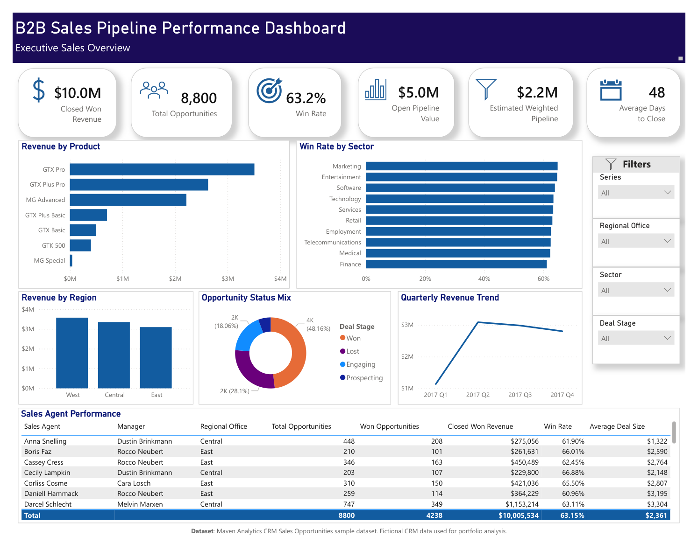
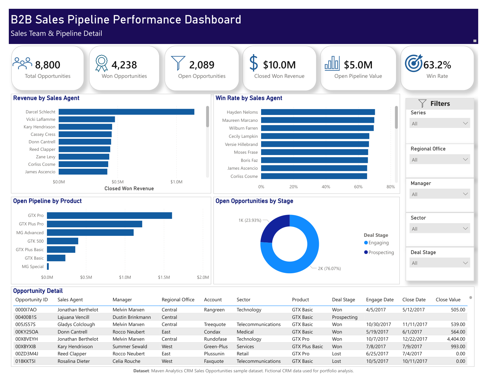

# B2B sales pipeline analysis

**Power BI | Power Query | DAX | SQL | Sales analytics**

A two-page Power BI report for reviewing sales performance and prioritizing a B2B hardware pipeline. The project connects opportunity-level CRM data to account, product, and sales-team dimensions, then checks headline measures against SQL.

| Closed won revenue | Closed-deal win rate | Open opportunities | Average days to close |
| --- | --- | --- | --- |
| **$10.01 million** | **63.2%** | **2,089** | **48 days** |

These results describe the full fictional dataset. Closed-deal win rate is won opportunities divided by won plus lost opportunities.



## Business question

Where is sales performance strongest, and which parts of the open pipeline should managers review next?

The executive page brings revenue, conversion, products, regions, and quarterly trends together. The detail page supports follow-up by sales agent, manager, account, product, and opportunity stage.

## Findings and business implications

- **West led closed won revenue at $3.57 million**, followed by Central at $3.35 million and East at $3.09 million. Compare regional opportunity mix and deal size before interpreting the revenue difference as a difference in selling effectiveness.
- **GTX Pro generated $3.51 million**, or 35.1% of total won revenue. GTX Pro and GTX Plus Pro together contributed 61.4%. Managers could use the product breakdown to review concentration and focus their pipeline discussions.
- **Quarterly revenue peaked at $3.09 million in Q2 2017**, then declined to $2.80 million in Q4, a 9.2% decrease from Q2. The next investigation would separate changes in deal volume, conversion, and average deal size.
- **1,589 of 2,089 open opportunities were Engaging**, representing 76.1% of the open pipeline by count. This gives managers a focused population for next-step and stalled-deal reviews.
- **1,425 opportunities have no account assigned**, all in open stages. Revenue totals remain measurable, but account and sector views cannot fully describe the open pipeline. Account assignment is a practical data-quality priority.

These are observations and proposed follow-up actions. The project does not claim that a business implemented the recommendations or achieved a measured improvement.

## Dashboard detail



[View the dashboard PDF](dashboard.pdf) · [Read the SQL checks](source-data-validation.sql) · [Inspect the DAX](model-calculations.dax) · [Explore the Power BI model](power-bi-model.md)

## Approach

1. **Validate the source.** Check table counts, deal stages, missing fields, unmatched lookup keys, revenue totals, and win-rate denominators in SQL.
2. **Clean the lookup values.** Normalize `GTXPro` to `GTX Pro` so opportunities match the Products table. Correct the sector spelling `technolgy` to `Technology` for reporting.
3. **Model the data.** Use Sales Pipeline as the opportunity fact table, with Accounts, Products, and Sales Teams as lookup tables. A calculated close-quarter column supports the quarterly revenue trend.
4. **Build the report.** Use Power Query preparation and DAX measures for revenue, opportunity counts, win rate, deal size, cycle time, and pipeline views.
5. **Reconcile the headline results.** Reload the original CSVs into a fresh SQLite database and rerun the source validation. The included Python runner adds reproducible normalization and extended reconciliation checks.

See [metric definitions and model notes](methodology.md) for denominators, joins, missing values, and forecast assumptions.

## Reproduce the SQL results

Python 3.10 or later is sufficient. The runner uses the standard library and does not require a database server or third-party Python packages.

```bash
python validate.py
```

The command loads the four CSVs into a fresh in-memory SQLite database, runs the original validation SQL plus the additional analysis, compares the results with the checked snapshot, and writes the new results to `output/validation-summary.json`. It stops with an error if a comparison fails. Source CSVs are preserved.

To inspect individual queries in a database tool, import the CSVs as `accounts`, `products`, `sales_teams`, and `sales_pipeline`, then run [source-data-validation.sql](source-data-validation.sql). [analysis.sql](analysis.sql) creates normalized views for the additional analysis. Its date functions use SQLite syntax.

## Files

| Location | Purpose |
| --- | --- |
| [Dashboard screenshots](dashboard-overview.png) | Existing Power BI dashboard screenshots |
| [Dashboard PDF](dashboard.pdf) and [methodology](methodology.md) | Dashboard PDF and methodology |
| [Source validation](source-data-validation.sql) and [analysis](analysis.sql) | Original source checks and reproducible analysis queries |
| [DAX definitions](model-calculations.dax), [Power Query](power-query.m) and [model notes](power-bi-model.md) | Source logic extracted from the original Power BI model; local file paths replaced with a portable parameter |
| [`validate.py`](validate.py) | Fresh-import validation runner |
| [Source CSVs](sales_pipeline.csv) | Attributed source CSVs and source notes |
| [`validation-summary.json`](validation-summary.json) | Checked metrics and data-quality results |

## Scope and limitations

This is a portfolio project using **fictional CRM data**, not client or employer records. The source has 8,800 opportunities, 85 accounts, 7 products, and 35 sales-team records. Closed opportunities fall in 2017. The dataset provides outcomes and dates, not a complete history of every stage change, so it cannot establish historical stage conversion or deal aging at an arbitrary past date.

The dashboard's approximately $5.0 million open pipeline is a **list-price estimate**, because open opportunities have no close value. Weighted pipeline totals **$2,160,911.70**, using the original DAX assumptions of **20% for Prospecting and 50% for Engaging**. It matches the dashboard's rounded $2.2 million and is reproduced in SQL. These weights define a scenario, not a calibrated forecast.

The report PDF and previews preserve the original Power BI analysis, with title spelling corrected in the export. Charts and numbers are unchanged. The repository adds documentation, extracted model logic and a repeatable SQL validation workflow. The original PBIX remains local because it embeds local source paths; the source definitions are provided as readable text.

## Data source

[Maven Analytics: CRM Sales Opportunities](https://mavenanalytics.io/data-playground/crm-sales-opportunities), a fictional B2B computer-hardware sales dataset. Maven lists the original source as **data.world** and the dataset license as **Public Domain**. The source page and license label were checked on October 16, 2026. See [methodology and data attribution](methodology.md#data-source-and-attribution) for table details and attribution.

Project by **Joshua Smith**.
