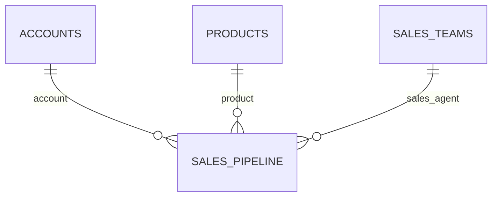

# Metric definitions and model notes

## Data grain and relationships

Each row in `sales_pipeline.csv` represents one opportunity, identified by `opportunity_id`. The checked source contains 8,800 distinct opportunity IDs and no duplicate dimension keys.

The extracted model confirms these three active lookup relationships. It also contains a Date Table and a DAX Measures table. The Date Table has no extracted relationship to the opportunity table; the quarterly visual uses the calculated `Close Year Quarter` column in Sales Pipeline. See the [actual model relationships](power-bi-model.md), [DAX definitions](model-calculations.dax) and [Power Query source](power-query.m).

## Checked measures

All figures below use the full, unfiltered snapshot.

| Measure | Definition | Verified value |
| --- | --- | ---: |
| Total opportunities | Count opportunity rows | 8,800 |
| Won opportunities | Stage = `Won` | 4,238 |
| Lost opportunities | Stage = `Lost` | 2,473 |
| Open opportunities | Stage = `Engaging` or `Prospecting` | 2,089 |
| Closed won revenue | Sum `close_value` for Won | $10,005,534 |
| Closed-deal win rate | Won / (Won + Lost) | 63.150052% |
| Average won deal size | Won revenue / won opportunities | $2,360.91 |
| Average days to close | Average close date minus engage date for Won and Lost | 47.985397 days |
| Open pipeline list-price estimate | Sum product list price across open opportunities | $4,966,215 |

Win rate excludes open opportunities. Dividing won opportunities by all opportunities would answer a different question and would produce 48.16%, the won share shown in the opportunity-status chart.

Closed won revenue is grouped by close date for the quarterly view. Q1 through Q4 2017 reconcile to the annual total: $1,134,672, $3,086,111, $2,982,255, and $2,802,496.

## Preparation and data quality

The source validation file is retained from the original project. The additional `analysis.sql` and Python runner make the same core results reproducible from CSV without Power BI.

- **Product matching:** raw `GTXPro` is mapped to `GTX Pro` in a view, leaving the source untouched. All opportunities then match a product.
- **Sector labels:** raw `technolgy` is corrected to `Technology` in a reporting view. Other sector labels receive title case.
- **Missing accounts:** 1,425 account values are missing: 1,088 Engaging and 337 Prospecting. They stay in overall opportunity and pipeline totals. Account-based filtering can exclude these rows, so filtered totals require care.
- **Open values and dates:** all 2,089 open opportunities lack a close date and close value, consistent with their open status. Missing close value is not replaced with zero revenue in the source.
- **Join checks:** every sales agent matches Sales Teams. Every populated account matches Accounts. After product normalization, every product matches Products. Lookup keys are unique, so these joins do not multiply opportunity rows.
- **Time checks:** closed opportunities have engage and close dates, and no close date precedes its engage date. Blank source dates are imported as SQL NULL before minimum/maximum checks.

## Pipeline estimates

Open opportunities do not have an actual close value. Joining each open opportunity to its product list price produces $3,892,229 for Engaging and $1,073,986 for Prospecting, or $4,966,215 in total. This reproduces the dashboard's rounded $5.0 million pipeline figure. It assumes one list-price item per opportunity and does not capture negotiated discounts or quantities.

The extracted original DAX uses a 20% weight for Prospecting and a 50% weight for Engaging. Applying those assumptions to product list prices gives $2,160,911.70, matching the rounded $2.2 million card. The SQL reproduction checks the same calculation. These are assumed stage probabilities, rather than a statistically calibrated forecast. A production version should back-test them against realized outcomes.

## Interpretation limits

Regional and agent revenue reflect the number and mix of assigned opportunities as well as performance. A difference in revenue alone does not establish a causal explanation or justify a personnel decision. The static source contains no activity log or record of successive stage changes. It supports outcome and snapshot analysis, not a historical stage-transition model.

## Data source and attribution

**Dataset:** CRM Sales Opportunities  
**Publisher:** Maven Analytics Data Playground  
**Source page:** https://mavenanalytics.io/data-playground/crm-sales-opportunities  
**Original source listed by Maven:** data.world  
**License label on the source page:** Public Domain  
**Source and license checked:** October 16, 2026

Maven describes the data as a fictional B2B company that sells computer hardware. The four data CSVs included here are preserved from the local source snapshot used for the dashboard. No employer or client CRM records are included.

| File | Grain | Rows |
| --- | --- | ---: |
| `sales_pipeline.csv` | One sales opportunity | 8,800 |
| `accounts.csv` | One account | 85 |
| `products.csv` | One product | 7 |
| `sales_teams.csv` | One sales agent | 35 |

The checked local row counts define this project's snapshot. They should not be inferred from the source website's current record-count display.

For a new download, visit the source page, download CRM Sales Opportunities, and extract the four data tables. The runner checks the supplied snapshot against the results in this repository, so a later source revision can produce an intentional comparison failure.

The raw CSVs retain original product spelling and sector labels. Normalization is expressed separately in SQL and documented in the preparation notes above.

The dataset license label applies to the source data. This repository does not claim ownership of Maven Analytics branding or third-party material.
